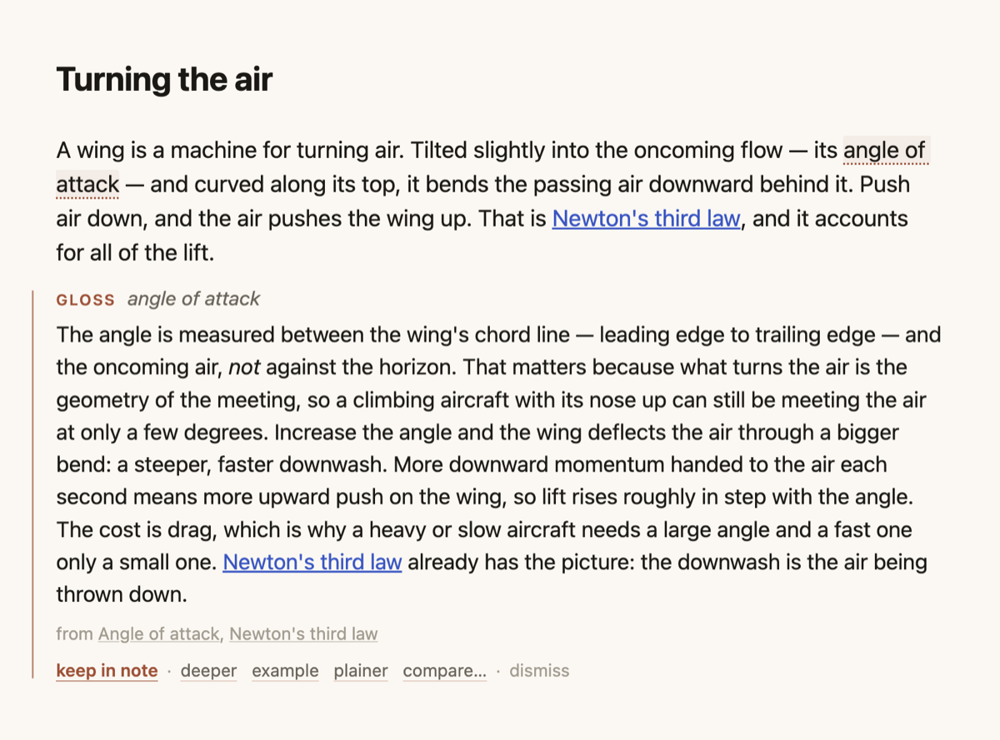
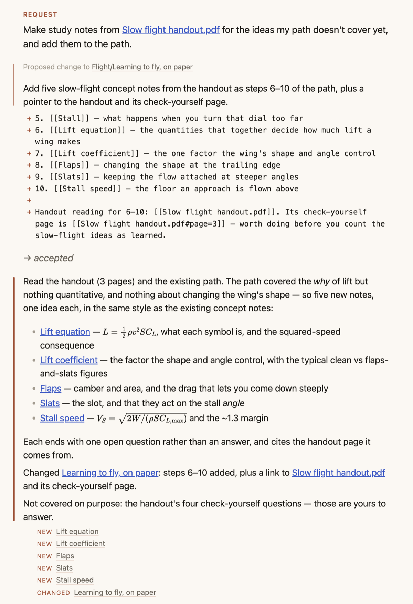

# ICAP Learning Agent

An Obsidian plugin for learning inside your own notes. There is no chat panel: explanations, questions and feedback appear in the note you are reading, and whatever you keep is plain Markdown. Its agent is [Pi](https://pi.dev), built into the plugin and connected to your own model provider.

**[中文说明](README.zh-CN.md)** · Desktop Obsidian 1.8.7+ · English and Chinese interface

## Features

- **Explain.** Select a word or passage; the explanation appears under it. Ask for deeper, an example, plainer, or a comparison, and keep it if it helped.
- **Recall.** Explain a section from memory. The agent answers what you actually wrote and asks a follow-up.
- **Check.** A few questions on a section or a whole note, with feedback on your answer.
- **Ask the agent here.** A request block anywhere in a note. Point at files with `[[` or `@`; use your Pi skills and commands with `/`.
- **Documents.** PDFs, EPUBs and Word files in the vault become readable trees: the agent opens a book's table of contents, reads only the chapters it needs, and cites pages you can click.
- **Interactive visuals.** Sliders and diagrams you can drag, in a sandbox with no network.
- **Activity.** Every task, and every file it created, changed or deleted.

Edits to your existing notes are proposed as a diff and applied only when you accept them. Notes stay readable without the plugin. The name comes from the ICAP framework (Chi & Wylie, 2014): learning deepens from **P**assive to **A**ctive, **C**onstructive and **I**nteractive.

## Install

Not in the community directory yet.

1. Download `main.js`, `manifest.json` and `styles.css` from the latest [release](https://github.com/EdwinZhanCN/obsidian-icap-agent/releases).
2. Put them in `<your vault>/.obsidian/plugins/icap-agent/`.
3. Enable **ICAP Learning Agent** under **Settings → Community plugins**.

The first launch opens a guide note that walks through every interaction. Coming from ICPA (`icpa-agent`)? ICAP imports its settings on first start; then remove the old plugin.

## Connect a model

Open **Settings → ICAP Learning Agent → Model providers → Log in…**, then sign in with a subscription (Claude Pro/Max, ChatGPT, GitHub Copilot…) or paste an API key. Pi stores it in `~/.pi/agent/auth.json`, shared with the Pi CLI. A key exported in your shell profile also works.

**Agent setup.** By default the agent runs with your own Pi setup (skills, extensions, MCP servers, shell) and can edit files directly; every change is listed in Activity. Choose **ICAP only (isolated)** for read-only tools inside the vault and the folders you allow.

## Network, accounts and files outside the vault

- **Network.** Requests, with the parts of your notes and documents the agent reads, go only to the model provider you choose. ICAP has no server, no telemetry and no analytics. Visuals have no network access. In the default setup your own Pi extensions and MCP servers may contact their own services.
- **Accounts.** You need an account with a model provider, which bills you directly. ICAP needs no account.
- **Files outside the vault.** ICAP reads Pi's folder `~/.pi/agent/` (settings, credentials, extensions, skills) and writes there when you sign in, change the model or trust a project, as the Pi CLI does. On first use it runs your login shell once to pick up missing environment variables such as provider keys. In isolated mode the agent reads only the outside folders you allow; in the default setup it has Pi's shell.
- **In the vault.** Settings and sessions live in `.obsidian/plugins/icap-agent/`; the document cache in `icap/docs/`.

## Troubleshooting and limitations

- **"No model has credentials":** log in under **Model providers**. A key added to `~/.zshrc` reaches Obsidian on its next launch; then press ↻.
- Desktop only (Pi needs Node.js). `main.js` is about 11 MB.
- Scanned PDFs without a text layer can't be read (no OCR).
- An explanation you haven't kept disappears when the plugin reloads.

## More

[DESIGN.md](DESIGN.md) (how it works) · [FORMAT.md](FORMAT.md) (what it writes into notes) · [CONTRIBUTING.md](CONTRIBUTING.md) · [MIT](LICENSE)
