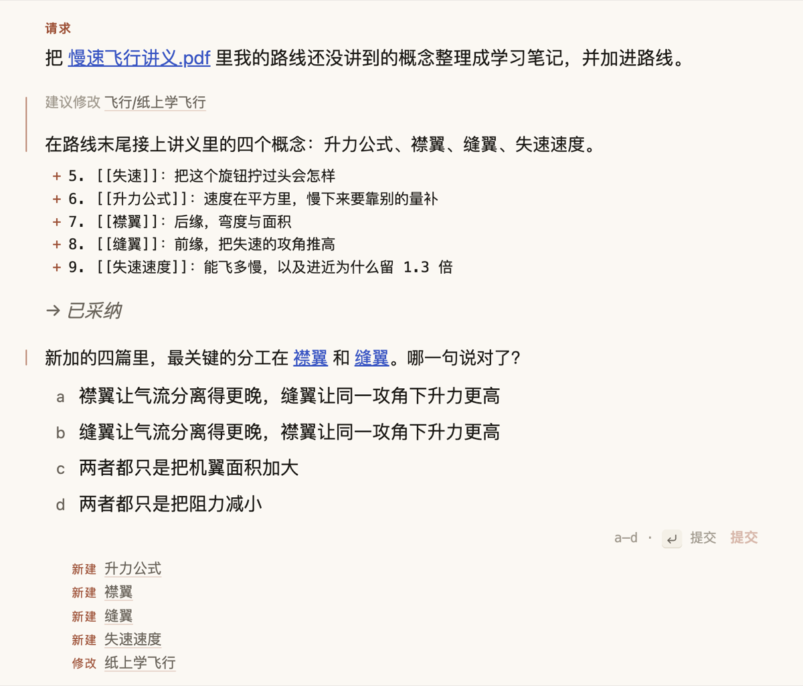

# ICAP Learning Agent

在自己的笔记里学习的 Obsidian 插件。没有聊天面板：解释、提问和反馈都出现在你正在读的笔记里，保留下来的都是普通 Markdown。它的 Agent 是 [Pi](https://pi.dev)，内置在插件里，使用你自己的模型服务商。

**[English](README.md)** · 桌面版 Obsidian 1.8.7+ · 中英文界面

## 功能

- **释义。** 选中一个词或一段话，解释出现在它下面。可以要更深入、举例、说浅一点或对比；有用就留在笔记里。
- **回忆。** 凭记忆复述一节，Agent 针对你写下的原话回应并追问。
- **理解检验。** 针对一节或整篇笔记出几道题，对你的回答给出反馈。
- **在这里问 Agent。** 在笔记任意位置插入请求块。用 `[[` 或 `@` 指定文件，用 `/` 调用你的 Pi 技能和命令。
- **资料。** 库里的 PDF、EPUB 和 Word 文档会整理成目录树：Agent 先看书的目录，只读需要的章节，并给出可点击的页码。
- **交互式图示。** 可以拖动的滑块和图，在不能联网的沙箱里运行。
- **活动。** 每项任务，以及它新建、修改、删除了哪些文件。

对已有笔记的修改会以差异的形式提出，你采纳之后才会生效。不装插件，笔记也能正常阅读。名字来自 ICAP 学习框架（Chi & Wylie, 2014）：从 **P**assive（被动）到 **A**ctive（主动）、**C**onstructive（建构）、**I**nteractive（互动），投入越深学得越扎实。

## 安装

在 Obsidian 中打开 **设置 → 第三方插件 → 浏览**，搜索 **ICAP Learning Agent**，点 **安装**，再 **启用**。

也可以手动安装：在最新的 [Release](https://github.com/EdwinZhanCN/obsidian-icap-agent/releases) 下载 `main.js`、`manifest.json`、`styles.css`，放到 `<你的库>/.obsidian/plugins/icap-agent/`，然后在该页面启用插件。

首次启用会打开一篇指南笔记，带你把每种交互都用一遍。从 ICPA（`icpa-agent`）升级：ICAP 首次启动时会导入旧设置，之后删除旧插件即可。

## 连接模型

打开 **设置 → ICAP Learning Agent → 模型服务商 → 登录…**，用订阅登录（Claude Pro/Max、ChatGPT、GitHub Copilot 等）或粘贴 API Key。凭证由 Pi 保存在 `~/.pi/agent/auth.json`，和 Pi 命令行共用。在 shell 配置里导出的密钥也能用。

Pi 没有列出的服务（Ollama、LM Studio、vLLM、中转站、任何兼容 OpenAI 的 API），用旁边的 **自定义端点…**：填名称、Base URL、Key 和模型 ID。它保存在 Pi 的 `~/.pi/agent/models.json`（Windows 是 `%USERPROFILE%\.pi\agent\models.json`），和 Pi 命令行共用。这里的 Key 是明文；填 `$NAME` 则改为读取环境变量。

**Agent 配置。** 默认情况下 Agent 使用你自己的 Pi 配置（skills、扩展、MCP、shell），可以直接改文件，每处改动都列在“活动”里。选择 **仅 ICAP（隔离）**，Agent 只有只读工具，只在库和你授权的文件夹内活动。

## 网络、账号和库以外的文件

- **网络。** 请求以及 Agent 为此读取的笔记和资料片段，只发给你选择的模型服务商。ICAP 没有服务器，没有遥测，也不做统计。交互式图示不能联网。默认配置下，你自己的 Pi 扩展和 MCP 可能连接各自的服务。
- **账号。** 需要一个模型服务商的账号，费用由服务商直接收取。ICAP 本身不需要账号。
- **库以外的文件。** ICAP 读取 Pi 的文件夹 `~/.pi/agent/`（设置、凭证、扩展、skills）；你登录、添加自定义端点、换模型或信任项目时，会像 Pi 命令行一样写入这里。首次使用时会运行一次登录 shell，补上缺少的环境变量（例如服务商密钥）。隔离模式下 Agent 只读你授权的库外文件夹；默认配置下它可以使用 Pi 的 shell。
- **库里的东西。** 设置和会话在 `.obsidian/plugins/icap-agent/`；资料缓存在 `icap/docs/`。

## 常见问题与限制

- **“没有任何模型配置了凭证”**：在“模型服务商”里登录。写进 `~/.zshrc` 的密钥要等 Obsidian 下次启动才生效，之后点 ↻。
- 仅支持桌面版（Pi 需要 Node.js）。`main.js` 约 11 MB。
- 扫描版 PDF（没有文字层）读不出来，没有 OCR。
- 没有保留的解释会在插件重新加载时消失。

## 更多

[DESIGN.md](DESIGN.md)（工作原理）· [FORMAT.md](FORMAT.md)（写进笔记的格式）· [CONTRIBUTING.md](CONTRIBUTING.md) · [MIT](LICENSE)
