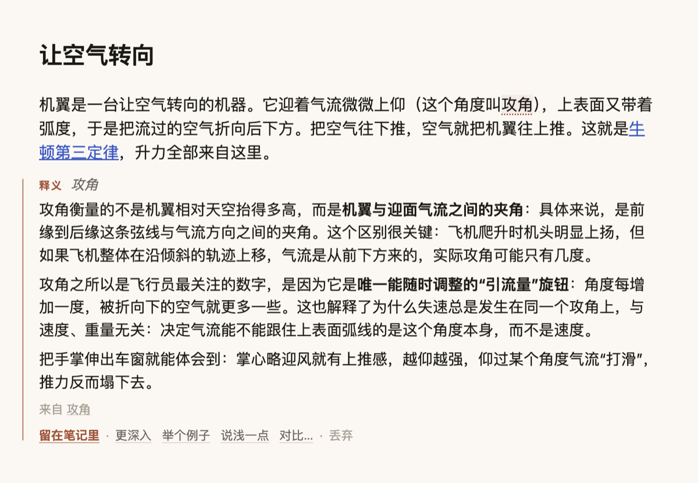
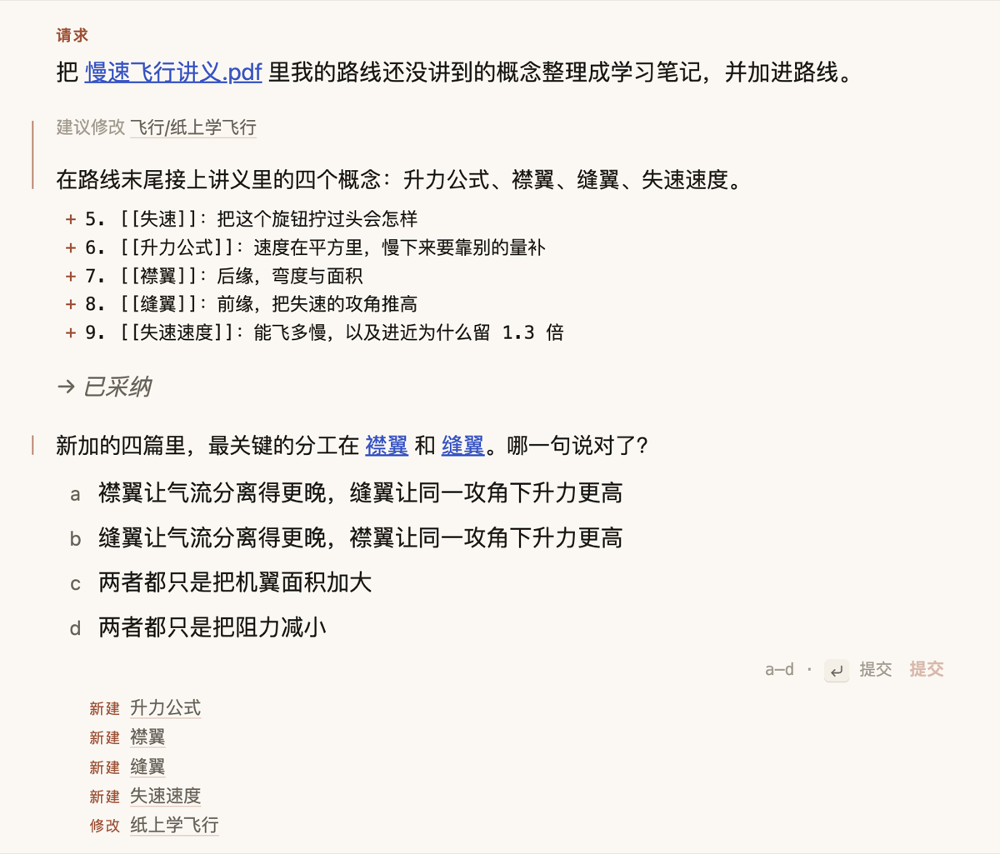

# ICAP Learning Agent

在自己的笔记里学习的 Obsidian 插件。没有聊天面板：解释、提问和反馈都出现在你正在读的笔记里，保留下来的都是普通 Markdown。它的 Agent 是 [Pi](https://pi.dev)，内置在插件里，使用你自己的模型服务商。

**[English](README.md)** · Obsidian 1.11.4+，桌面、iPhone、iPad 和 Android · 中英文界面

## 功能

- **释义。** 选中一个词或一段话，解释出现在它下面。可以要更深入、举例、说浅一点或对比；有用就留在笔记里。
- **回忆。** 凭记忆复述一节，Agent 针对你写下的原话回应并追问。
- **理解检验。** 针对一节或整篇笔记出几道题，对你的回答给出反馈。
- **在这里问 Agent。** 在笔记任意位置插入请求块。用 `[[` 或 `@` 指定文件，用 `/` 调用你的 Pi 技能和命令。
- **资料。** 库里的 PDF、EPUB 和 Word 文档会整理成目录树：Agent 先看书的目录，只读需要的章节，并给出可点击的页码。
- **交互式图示。** 可以拖动的滑块和图，在不能联网的沙箱里运行。
- **活动。** 状态栏显示 Agent 正在做什么，并列出最近的任务：状态、花费（token、缓存命中、价格），以及新建、修改了哪些文件。打开「把任务记录成笔记」后，每个真正干了活的任务还会得到一篇带属性的笔记，列在一个原生 Base（`ICAP/Activity.base`）里，可以筛选、分组、自己改；点任务名回到你提问的位置。

对已有笔记的修改会以差异的形式提出，你采纳之后才会生效。不装插件，笔记也能正常阅读。名字来自 ICAP 学习框架（Chi & Wylie, 2014）：从 **P**assive（被动）到 **A**ctive（主动）、**C**onstructive（建构）、**I**nteractive（互动），投入越深学得越扎实。

## 安装

在 Obsidian 中打开 **设置 → 第三方插件 → 浏览**，搜索 **ICAP Learning Agent**，点 **安装**，再 **启用**。

也可以手动安装：在最新的 [Release](https://github.com/EdwinZhanCN/obsidian-icap-agent/releases) 下载 `main.js`、`manifest.json`、`styles.css`，放到 `<你的库>/.obsidian/plugins/icap-agent/`，然后在该页面启用插件。

首次启用会打开一篇指南笔记，带你把每种交互都用一遍。从 ICPA（`icpa-agent`）升级：ICAP 首次启动时会导入旧设置，之后删除旧插件即可。

## 连接模型

打开 **设置 → ICAP Learning Agent → 模型服务商 → 登录…**，用订阅登录（Claude Pro/Max、ChatGPT、GitHub Copilot 等）或粘贴 API Key。凭证由 Pi 保存在 `~/.pi/agent/auth.json`，和 Pi 命令行共用。在 shell 配置里导出的密钥也能用。

Pi 没有列出的服务（Ollama、LM Studio、vLLM、中转站、任何兼容 OpenAI 的 API），用旁边的 **自定义端点…**：填名称、Base URL、Key 和模型 ID。它保存在 Pi 的 `~/.pi/agent/models.json`（Windows 是 `%USERPROFILE%\.pi\agent\models.json`），和 Pi 命令行共用。这里的 Key 是明文；填 `$NAME` 则改为读取环境变量。

**在手机或平板上。** Pi 需要 Node，而 Obsidian 移动版没有 Node，所以 ICAP 在那里运行自己的 Agent：基于 Pi 的模型库，只有 ICAP 自己的工具。打开 **设置 → ICAP Learning Agent → 模型服务商**，为 Anthropic、OpenAI、Google Gemini、OpenRouter、DeepSeek、Mistral、Groq 或 xAI 添加 API Key。Key 只保存在这台设备的 Obsidian 钥匙串里：不进入库，也不会同步，所以每台设备各自添加。**添加端点…** 可以连接局域网里的 Ollama 或 LM Studio、中转站，或任何兼容 OpenAI / Anthropic 的 API。保存时 ICAP 会检查一次服务器是否允许应用以流式方式访问；不允许时，回复经由 Obsidian 转发、整段到达：你看到的是“等待完整回复…”而不是逐字出现，停止只是停止等待（这次请求仍会计费）。订阅登录、Bedrock 和 Vertex 只在桌面版可用。手机上选的模型和桌面版各自独立。

**Agent 能做什么。** 由 **高级** 里的两项设置决定。

- **工具范围。** *ICAP 和库内文件（隔离）* 是默认值：Agent 向你提问、新建笔记，读取和修改库内的文件。*加上 shell 和 Connector（完整）* 还包括 shell、你的 Connector（Pi 的 `mcp.json` 里的 MCP 服务器）、库外的文件，以及你的 Pi skills 和提示模板。
- **确认方式。** *逐项确认* 是默认值：每处改动先在笔记里出 diff，每条 shell 命令和每次 Connector 调用都会问。*自动接受编辑*：库内的改动直接写入，diff 留在块里。*跳过全部确认*：什么都不问；在完整工具范围下，这意味着这台电脑上的任何东西，所以开启前 ICAP 会显示警告。

无论怎么选，写入 Obsidian 自己的文件夹或 Pi 的文件夹始终要问；每个被改动文件的原文在插件文件夹里保留一个月；每处改动都列在“活动”里。

**你自己的 Pi。** 如果你已经[安装了 Pi](https://pi.dev)（1.5.0 或更高），在 **运行哪个 Pi** 里选择 **你自己安装的**，每个任务就会把你的 `pi` 作为独立进程启动，不再使用插件内置的那一个。你的扩展在 Pi 自己的进程里运行，和在终端里一样。登录、模型、MCP 服务器和会话用的是同一批文件，两种方式通用。ICAP 在 PATH 里查找 Pi，或使用你在 **Pi 的位置** 里填写的路径；它不会安装或更新 Pi。要使用 Pi 扩展，就用这种方式。你自己的 Pi 按它自己的规则行动：上面两项设置对它不起作用，ICAP 只记录它改了什么，不做审查。

## 网络、账号和库以外的文件

- **网络。** 请求以及 Agent 为此读取的笔记和资料片段，只发给你选择的模型服务商。ICAP 没有服务器，没有遥测，也不做统计。交互式图示不能联网。在完整工具范围下，你的 Connector 会连接各自的服务；你自己的 Pi 的扩展也一样。
- **账号。** 需要一个模型服务商的账号，费用由服务商直接收取。ICAP 本身不需要账号。
- **库以外的文件。** ICAP 读取 Pi 的文件夹 `~/.pi/agent/`（设置、凭证、扩展、skills）；你登录、添加自定义端点、换模型或信任项目时，会像 Pi 命令行一样写入这里。首次使用时会运行一次登录 shell，补上缺少的环境变量（例如服务商密钥）。隔离的工具范围下，Agent 只读你授权的库外文件夹，只写库内的文件；完整范围下它有 shell。选择 **你自己安装的** 时，ICAP 为每个任务启动你电脑上的 `pi` 程序，并通过一个只有你的系统账户能打开的 socket 与它通信；不监听任何网络端口。
- **在手机上。** 不读取库以外的任何东西。API Key 在设备的 Obsidian 钥匙串里。
- **库里的东西。** 设置和会话在 `.obsidian/plugins/icap-agent/`；资料缓存（`docs/`）也在那里。只有打开「把任务记录成笔记」后，库里才会有任务笔记和 `Activity.base`。

## 常见问题与限制

- **“没有任何模型配置了凭证”**：在“模型服务商”里登录。写进 `~/.zshrc` 的密钥要等 Obsidian 下次启动才生效，之后点 ↻。
- `main.js` 约 9 MB：桌面版用的 Pi，加上手机 Agent 用的模型库；手机只加载后者。
- **从 1.3 或更早版本升级，且原来用的是“你的 Pi 配置”：** 如果装有 Pi 1.5.0 或更高版本，ICAP 现在运行它，一切照旧。如果没有，ICAP 继续用内置 Agent，完整工具范围、不做确认，和以前一样，但 Pi 扩展不再加载；会显示一次通知说明。
- **手机上：** 没有 Pi 配置（你的 skills、扩展、MCP、`/compact`），没有文件和 shell 工具，不能访问库以外的文件夹。会话不在手机上缓存，请求块的每一轮都会把对话重新发给模型。如果回复途中 iOS 把 Obsidian 挂起，任务会暂停；回到 Obsidian 点 **继续** 即可。
- 扫描版 PDF（没有文字层）读不出来，没有 OCR。
- 没有保留的解释会在插件重新加载时消失。

## 更多

[DESIGN.md](DESIGN.md)（工作原理）· [FORMAT.md](FORMAT.md)（写进笔记的格式）· [CONTRIBUTING.md](CONTRIBUTING.md) · [MIT](LICENSE)
